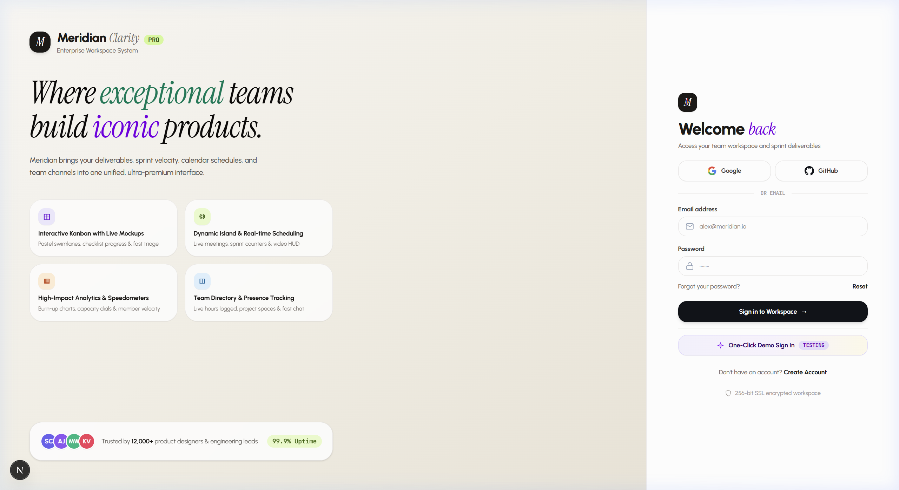
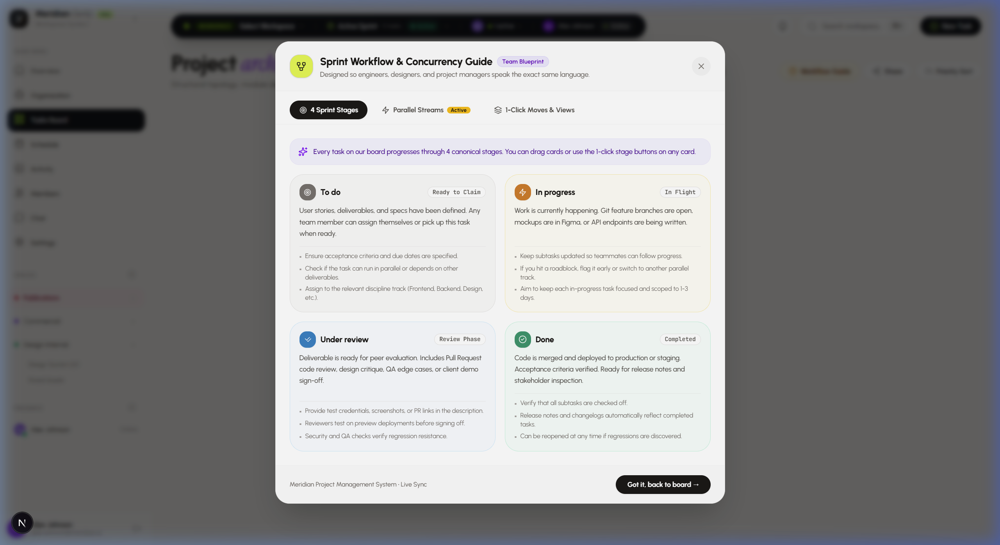
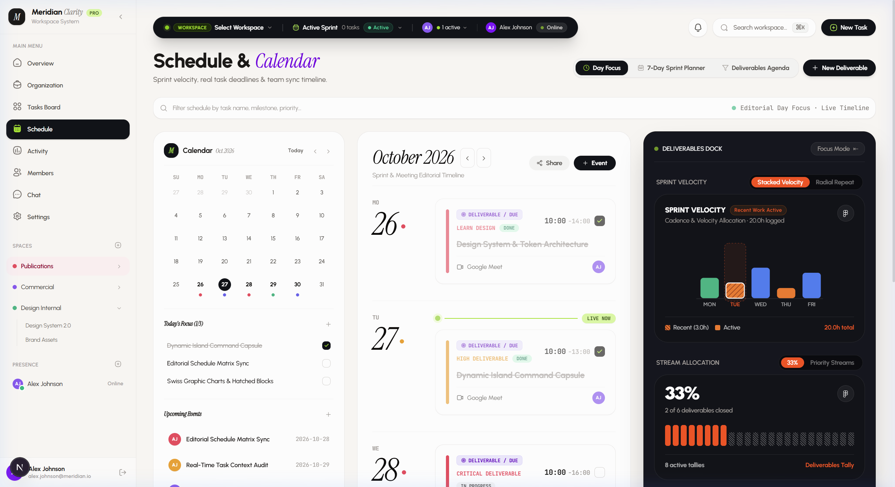
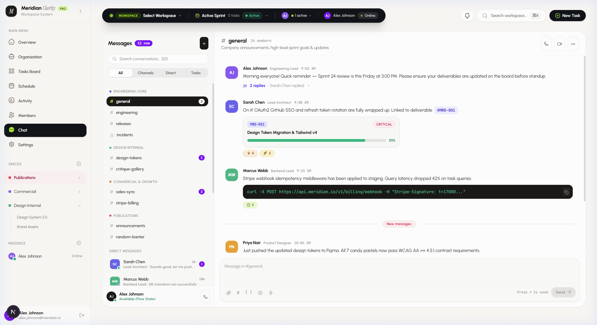
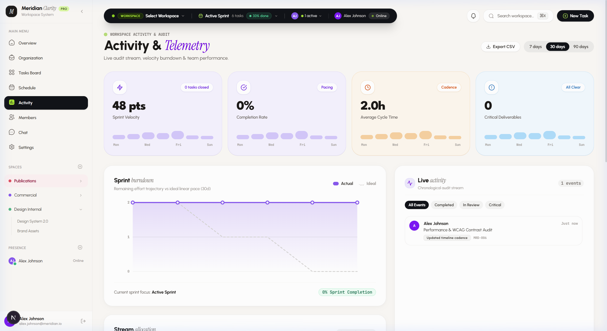

# Meridian Clarity Pro
### The Haute-Horlogerie of Sprint Orchestration & Workspace Architecture

<br />

<p align="center">
  
</p>

<p align="center">
  <strong>A design-engineered workspace operating system replacing legacy ticket sprawl with tactile luxury, mechanical precision, and parallel sprint concurrency.</strong>
</p>

<p align="center">
  Built for hyper-growth engineering squads, high-craft design studios, and product organizations that refuse to work in sterile, gray spreadsheets.
</p>

<br />

---

## 1. Design Manifesto: Tactile Luxury, Editorial Precision

For over a decade, enterprise project management has suffered from sterile minimalism: flat gray boxes, lifeless buttons, and cold hospital-white backgrounds that reduce intellectual product creation to administrative drudgery.

**Meridian Clarity Pro** rejects digital sterility. We believe:

* **Work is Craft:** An orchestrator for high-caliber creators should look and feel like a bespoke mechanical chronograph, a Leica M body, or a precision synthesizer from Teenage Engineering.
* **Warmth Over Hospital White:** Natural daylight is warm. Meridian is built upon a substrate of warm alabaster, crushed stone, and woven linen (`#FAF8F5`, `#F4F0E6`), eliminating visual fatigue across 12-hour engineering sprints.
* **The High-Low Typographic Contrast:** Utilitarian geometric typography (*Urbanist*, *Plus Jakarta Sans*) provides architectural framing, while literary italic serifs (*Instrument Serif*) impart editorial soul, artistic gravity, and poise.
* **Mechanical Tactility (Neo-Skeuomorphism 2.0):** Interactive elements possess physical mass. Buttons depress with spring-damped resistance, segmented pills slide with kinetic momentum, and surfaces feature micro-fine ambient occlusion shadows.

```
                  THE MERIDIAN ARCHITECTURAL MATRIX
                                  │
         ┌────────────────────────┼────────────────────────┐
         ▼                        ▼                        ▼
  WARM SUBSTRATE           HAUTE TYPOGRAPHY         TACTILE PHYSICS
  • Alabaster Canvas       • Instrument Serif       • Kinetic Springs
  • Soft Bento Tiles       • Urbanist Sans          • Elastic Segmented Pills
  • Obsidian Docks         • Tabular Monospace      • Multi-Tier Spatial Depth
```

<br />

---

## 2. Why Meridian Stands Apart from Legacy Giants

Legacy tools like Jira, Asana, and Monday were architected for 2010 bureaucracy, prioritizing endless hierarchical configuration over human velocity and optical comfort. Meridian is purpose-built for the modern product studio.

| Dimension | Legacy Giants (Jira, Asana, Monday) | Meridian Clarity Pro |
| :--- | :--- | :--- |
| **Interaction Latency** | 800ms–1,500ms ticket opening with page reloads | Sub-50ms optimistic state propagation with instant tactile drawers |
| **Sprint Concurrency** | Single-queue linear backlogs with artificial blockers | 5-Stream Parallel Concurrency Engine with horizontal swimlanes |
| **Visual Ergonomics** | Harsh sterile white backgrounds & flat gray tables | Warm Alabaster substrate (`#FAF8F5`) with WCAG AA candy pastels |
| **Navigation Model** | Buried 4-level navigation menus and nested sidebars | Floating Obsidian Dynamic Island capsule with keyboard-first `Cmd+K` |
| **Communication Flow** | Disconnected Slack threads and stale comment chains | Live channel directory with native deliverable cards & code embeds |
| **Time & Planning** | Rigid Gantt charts requiring manual drag calibration | Haute-horlogerie editorial schedule dock with live sprint velocity |
| **Typography** | Default system sans with zero emotional hierarchy | High-contrast pairing of *Instrument Serif* and geometric *Urbanist* |

<br />

---

## 3. Product Architecture & Core Capabilities

### 3.1 Parallel Tasks Concurrency Engine & Horizontal Swimlanes

Traditional task boards force cross-functional teams into a single sequential queue, causing frontend developers to stall while waiting on backend contracts, or QA engineers to idle until feature freezes.

Meridian introduces the **Parallel Streams Concurrency Engine**. Every deliverable is cataloged into one of 5 canonical execution streams:

* **TRK-FE (Frontend Stream):** Design token implementation, client state, interface components.
* **TRK-BE (Backend Stream):** API routes, database schemas, authentication middleware, background queues.
* **TRK-DS (Design Stream):** Figma component libraries, editorial tokens, UX copy, design QA.
* **TRK-QA (QA & Security):** Test harnesses, penetration testing, cross-browser validation, accessibility audits.
* **TRK-OPS (DevOps Stream):** CI/CD pipelines, container orchestration, edge caching, serverless infrastructure.

<br />

<p align="center">
  
</p>

Teams can toggle seamlessly between a traditional **4-Column Kanban View** and **Horizontal Parallel Swimlanes**, allowing each discipline to observe their independent velocity while tracking unified milestone dependencies.

<br />

---

### 3.2 Haute-Horlogerie Schedule & Deliverables Dock

The schedule view unifies chronological milestone tracking, meeting coordination, and capacity allocation into a single editorial spread.

<br />

<p align="center">
  
</p>

#### Highlights:
* **The Deliverables Dock:** An obsidian command module featuring live **Stacked Velocity** telemetry, hatched work allocation blocks, and urgency tallies.
* **Editorial Day Focus:** Single-click date scrubbing that highlights active day deliverables while keeping the 30-day macro sprint in context.
* **Unified Event Orchestration:** Direct integration with Google Meet and video sync rooms alongside deliverable deadlines.

<br />

---

### 3.3 Collaborative Channel Directory & Embedded Deliverable Cards

Meridian collapses the friction between project management and team conversation. Rather than pasting stale URLs into third-party chat clients, discussion lives directly beside sprint deliverables.

<br />

<p align="center">
  
</p>

#### Highlights:
* **Live Deliverable Embeds:** Direct mentions of deliverables (e.g. `#MRD-001`) automatically expand into interactive progress cards with real-time status chips and urgency tags.
* **Integrated Developer Context:** Syntax-highlighted code blocks, curl snippets, and commit references rendered natively within the discussion stream.
* **Team Presence Beacons:** Real-time presence indicators displaying flow-state status, active focus areas, and team timezones.

<br />

---

### 3.4 Live Telemetry & Sprint Velocity Engine

Engineering and design leadership require continuous visibility into delivery pacing without micro-managing individual contributors.

<br />

<p align="center">
  
</p>

#### Highlights:
* **Sprint Burndown Trajectory:** Real-time actual effort versus ideal linear pacing mapped across the 30-day sprint cycle.
* **Precision Telemetry Dials:** Live cycle-time calculators, velocity points closed, and critical path deliverable counters.
* **Real-time Activity Stream:** Chronological audit trail logging task stage progressions, subtask completions, and reviewer approvals.

<br />

---

## 4. The Meridian Design Token Ecosystem

Meridian's signature aesthetic is anchored in an uncompromising design system that balances optical softness with mathematical contrast.

### 4.1 The Signature Candy Pastel Spectrum
All color tokens comply with **WCAG AA (contrast ratio >= 4.5:1)** for body text against soft tinted backgrounds:

| Swatch | Color Name | Background | Foreground Text | Accent Border | Semantic Application |
| :---: | :--- | :--- | :--- | :--- | :--- |
|  | **Lavender Mist** | `#EDE9FE` | `#6D28D9` | `#DDD6FE` | Frontend Development, Design Tokens |
|  | **Amber Glow** | `#FFEDD5` | `#C2410C` | `#FDBA74` | Backend Services, API Contracts |
|  | **Spring Lime** | `#ECFCCB` | `#3F6212` | `#D9F99D` | Active Sprints, Online Presence, High Velocity |
|  | **Arctic Sky** | `#E0F2FE` | `#0369A1` | `#BAE6FD` | DevOps Infrastructure, Cloud Deployments |
|  | **Editorial Rose** | `#FFE4E6` | `#BE123C` | `#FECDD3` | Critical Path, Blockers, High-Priority Issues |
|  | **Mint Emerald** | `#DCFCE7` | `#15803D` | `#BBF7D0` | Shipped Deliverables, Verified Pull Requests |
|  | **Solar Gold** | `#FEF9C3` | `#854D0E` | `#FEF08A` | Code Review Phase, QA Audits |
|  | **Obsidian Night** | `#111318` | `#FFFFFF` | `rgba(255,255,255,0.12)` | Dynamic Island HUD, Floating Controls |

<br />

### 4.2 Spatial Canvas Hierarchy
The user interface is structured in four physical elevation planes:

```
[Layer 4: Overlays]  ── Modals, Drawers, Dynamic Island (Obsidian #111318 + Backdrop Blur)
[Layer 3: Floating]  ── Kinetic Member Cards, Dragging Kanban Cards (16px–32px Ambient Shadow)
[Layer 2: Surfaces]  ── Bento White Tiles (#FFFFFF, 24px Border Radius, Micro Hairline Border)
[Layer 1: Canvas]    ── Warm Alabaster Substrate (#FAF8F5 / #F4F0E6)
```

<br />

---

## 5. Technology Foundation

Meridian is engineered on a modern, high-performance web stack designed for rapid local rendering and edge scalability:

* **Application Framework:** Next.js 16 (App Router with Turbopack)
* **View Layer:** React 19 (Server Components, Optimistic State Transitions)
* **Styling Engine:** Tailwind CSS v4 with bespoke token variables
* **Iconography:** Bespoke native SVG token architecture (zero dependency bloat)
* **Typography:** Google Fonts (*Instrument Serif*, *Urbanist*, *Plus Jakarta Sans*, *JetBrains Mono*)
* **Persistence & Schema:** Relational SQL architecture with connection pooling and optimistic rollback snapshots
* **Security & Auth:** Argon2id password hashing, stateless JWT session tokens, and cryptographic OTP verification

<br />

---

## 6. Product Status & Vision

Meridian Clarity Pro is designed as a sovereign, multi-tenant workspace operating system. It demonstrates how modern enterprise software can simultaneously satisfy the rigorous productivity demands of principal engineers and the exacting aesthetic sensibilities of award-winning designers.

<br />

<p align="center">
  <sub>Crafted with obsessive precision for teams who believe how tools feel directly shapes what they build.</sub>
</p>
